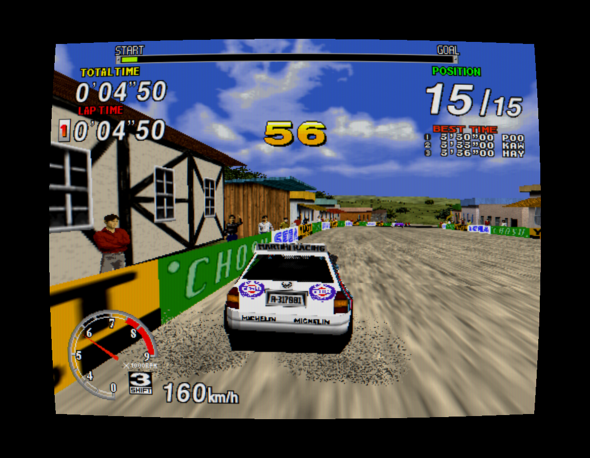
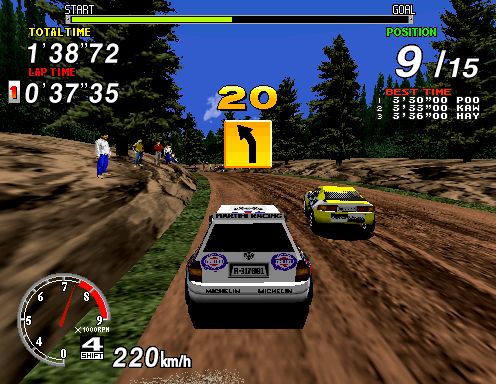
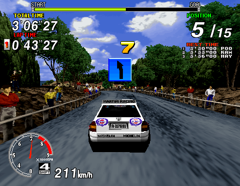
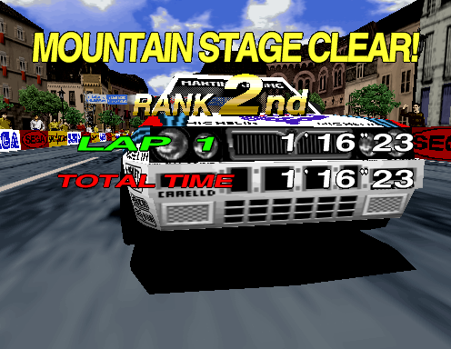
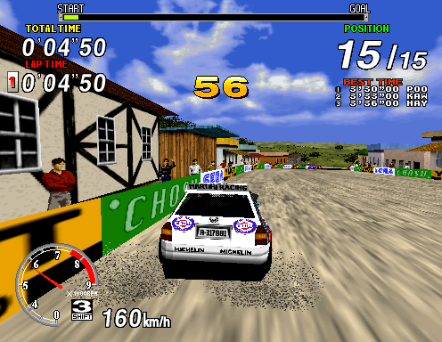

<div align="center">

# Sega Rally Championship

### The Model 2A rally classic. Native on Mac.

Generated C++ game code · Native board devices · SDL3 + Metal

[](docs/releases/v0.1.0-rc.1.md)
[](docs/getting-started.md)
[](docs/segarally-architecture.md)
[](https://github.com/LaurentGarcia/sega-rally-recomp/actions/workflows/build.yml)
[](LICENSE)

**[Build your Mac app](docs/getting-started.md) · [Player manual](docs/mac-player-manual.md) · [Architecture](docs/segarally-architecture.md) · [Tested scope](docs/segarally-status.md)**



*The production Metal CRT shader applied to a preserved native frame. [Capture details](docs/images/README.md) · [Original pixels](docs/images/hero.png).*

</div>

## Gravel, gears and native code

This project brings Sega Rally Championship (1995, Model 2A) to macOS through
static recompilation. Your verified Revision B ROMs become native C++ locally;
shared hardware code supplies the arcade board's devices, geometry and sound.
SDL3 and Metal put the result on your Mac.

| Drive | Make it yours | Keep it reproducible |
| :--- | :--- | :--- |
| Keyboard and recognized SDL gamepads | Remappable controls and analog response | Verified ROM manifests and pinned dependencies |
| Analog steering, accelerator and brake | Optional CRT effects and Accurate textures | Local import, generation, build and test pipeline |
| Native SCSP sound and cabinet saves | Paused Settings; windowed or fullscreen play | Cabinet-input recording and exact offline replay |

**Experimental source prerelease:** `v0.1.0-rc.1` supplies source and tools, not
ROMs, generated game code or a ready-to-play app. macOS is the active target;
phone work is deferred. Display enhancements start off on fresh preferences.

## On the stages

<table>
<tr>
<td width="33%"></td>
<td width="33%"></td>
<td width="33%"></td>
</tr>
<tr>
<td align="center"><b>Forest</b></td>
<td align="center"><b>Mountain</b></td>
<td align="center"><b>Practice Mountain · Stage Clear</b></td>
</tr>
</table>

The hero demonstrates the optional Arcade CRT preset: scanlines, phosphor mask,
glow, curvature and subtle color fringing. It uses the production shader on Metal
with a preserved Accurate textures frame. Effects remain adjustable and off by
default. The gallery uses the native CPU renderer; its preserved validation
captures predate this source prerelease.

<details>
<summary><b>Compare original pixels and Arcade CRT — the same frame</b></summary>

<table>
<tr><th>Original native output</th><th>Arcade CRT on Metal</th></tr>
<tr>
<td width="50%"><a href="docs/images/hero.png"></a></td>
<td width="50%"><a href="docs/images/crt.png"></a></td>
</tr>
</table>

The original is 496 × 384; the CRT capture uses a 992 × 768 viewport within a
1152 × 896 render target. Open the CRT image at full size to see the mask and
scanlines without the browser's downscaling. This is a presentation capture,
not a new gameplay or full-fidelity test.

</details>

Recorded Championship paths clear Desert and Forest before retiring near
Mountain's finish. A separate SHORT Practice Mountain drive finishes, reaches
name entry and the scoreboard, then returns to attract.

**Full Championship completion is not established.** Championship Mountain and
Practice Lakeside still lack finish evidence. Screenshots show particular
captured moments; they do not certify full-game graphics or arcade fidelity.
See the [evidence record](docs/segarally-status.md) for exact validation bounds.

## Build. Start. Rally.

Follow **[Getting started on macOS](docs/getting-started.md)** for the Apple
toolchain, Python, CMake and three pinned dependencies. Then, from your checkout:

```sh
python3 scripts/segarally_mac.py --roms /path/to/srallyc.zip \
    --output build/segarally-player --jobs 4
```

The pipeline verifies your Revision B inputs, generates main CPU/TGP/sound code,
builds Release, runs host tests and packages an ad-hoc signed local app. Open:

```text
build/segarally-player/mac/Sega Rally Native.app
```

The app targets the build Mac's architecture and is not notarized. Keep it and
its personal game assets local. Sound and the faster exact execution path are
enabled on direct no-argument startup; allow the original reset checks to finish.

| Start a game | Drive | Settings |
| :--- | :--- | :--- |
| **C** twice, then **Return** | **← / →** steer · **Z** gas · **X** brake | **F1** or controller **Y** |
| Press and release each coin input | **V** view · **A / S** gears · **Space** handbrake | **F6** CRT · **Escape** close/quit |

Two coins buy a credit with fresh cabinet settings. Xbox defaults, automatic
Lancia/Practice selection, saves and recording are in the
**[player manual](docs/mac-player-manual.md)**.

## Under the hood

The importer checks ROM sizes, CRC32 and SHA1 against committed manifests.
Static recompilers emit reached i960, TGP and 68000 instructions into ignored
local build output. The native runtime supplies memory, ordered device events,
I/O, video and SCSP sound. SDL3 handles input, audio output and Metal presentation.
Missing code and unsupported hardware stop with diagnostics instead of skipping
behavior.

Full-game raster fidelity, extended-precision floating point, physical timing
and full MAME-machine/PCB comparison remain open. A measured playback-buffer
starvation mechanism is fixed; broader listening feedback is still needed.
There is no fidelity certification or guaranteed frame rate.

| Explore | Read |
| :--- | :--- |
| Set up and build | [Getting started](docs/getting-started.md) · [Build and validation](docs/segarally-build-validation.md) |
| Understand the runtime | [Architecture and diagram](docs/segarally-architecture.md) · [Project design](docs/sega-rally-design.md) |
| Review the evidence | [Status and limits](docs/segarally-status.md) · [Input and replay contract](docs/segarally-input-replay.md) |
| Help improve it | [Contributing](CONTRIBUTING.md) · [Prerelease scope](docs/releases/v0.1.0-rc.1.md) |

The [documentation index](docs/README.md) provides the full map. Inherited Daytona
reference targets and their results do not establish Rally compatibility.

## Credits and source boundaries

Started from **[alphanu1/daytona-arcade-recomp](https://github.com/alphanu1/daytona-arcade-recomp)**
at `b33baeb28a1e1c94d90a4a80811f0b2c7f61106b`, retaining its history and
[BSD-3-Clause license](LICENSE). Dependency revisions, licenses and notices are
recorded in [THIRD_PARTY.md](THIRD_PARTY.md).

This project reconstructs behavior; it is not Sega's original source code and
is not affiliated with Sega. Sega Rally Championship and related names belong
to their respective owners. No leaked source or SDK is used.

The public repository contains source, manifests, tests, analysis and curated
documentation screenshots. Personal ROMs, generated game code, extracted runtime
assets, raw captures and playable apps remain excluded. Screenshots are
illustrations, not game files or a substitute for supplying your own ROMs.
