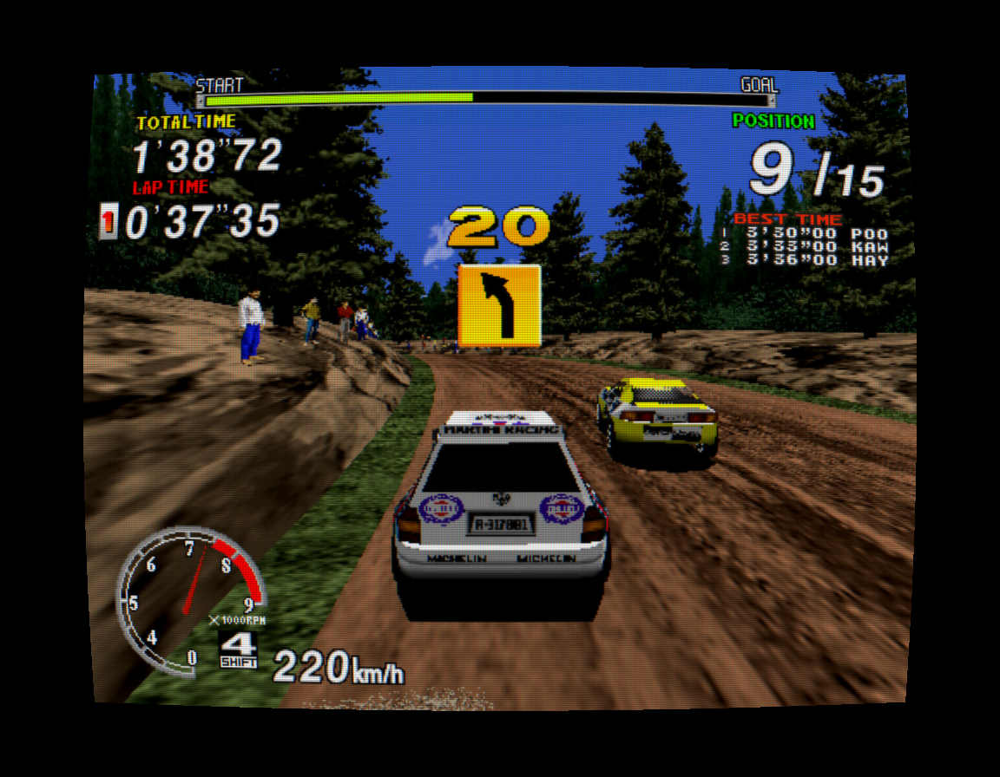
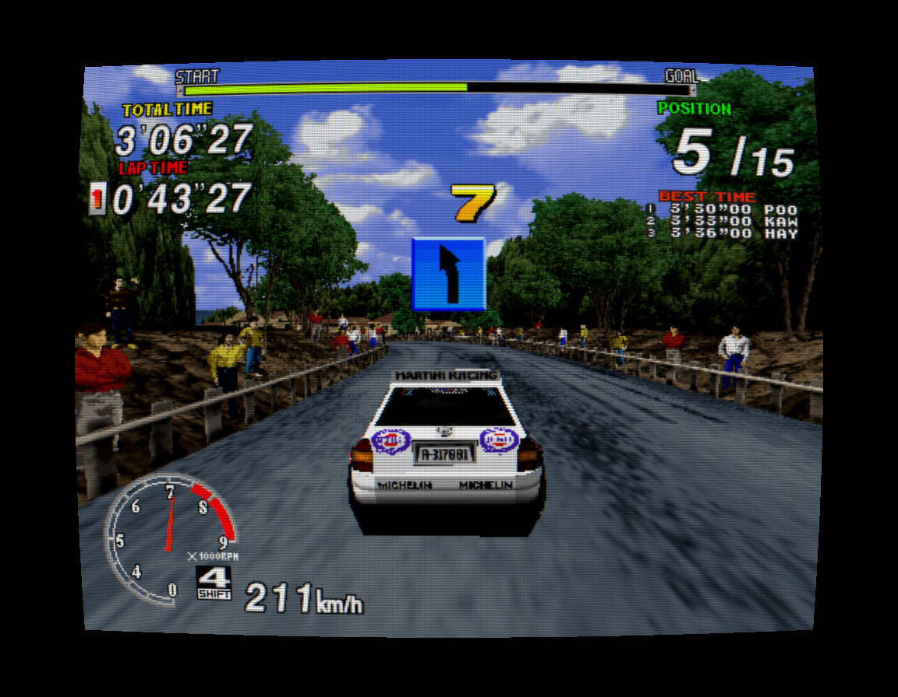
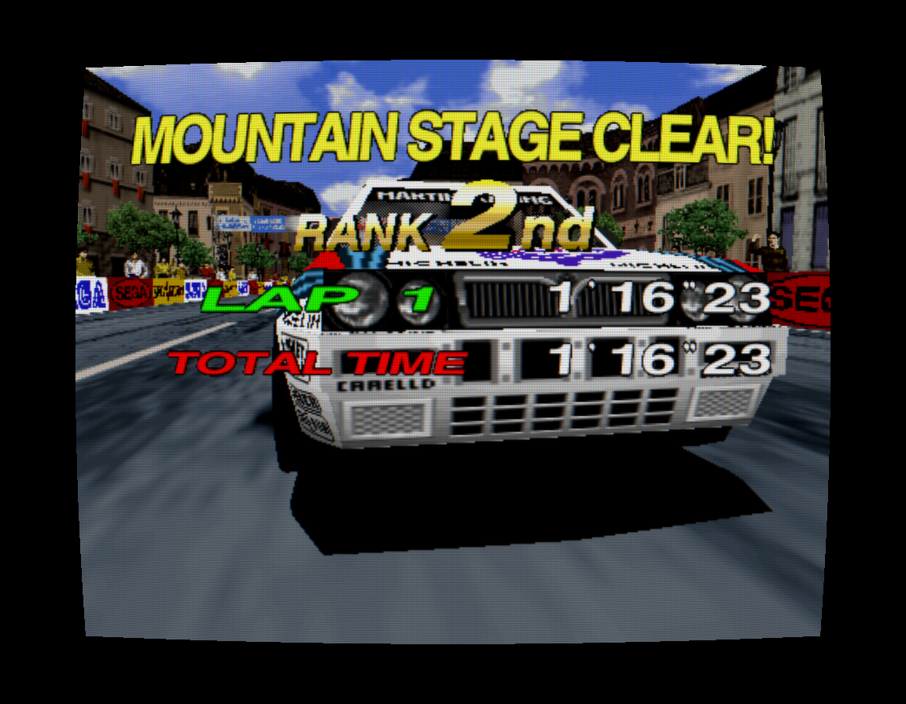

<div align="center">

# Sega Rally Championship

### The Model 2A rally classic. Native on Mac, Windows and Linux.

Generated C++ game code · Native board devices · Metal + Vulkan

**Original arcade game by SEGA.** This is an unofficial project, not affiliated
with or endorsed by SEGA.

[](https://github.com/LaurentGarcia/sega-rally-recomp/releases/tag/v0.1.0-player.4)
[](docs/releases/v0.1.0-rc.1.md)
[](docs/release-platforms.md)
[](docs/segarally-architecture.md)
[](https://github.com/LaurentGarcia/sega-rally-recomp/actions/workflows/build.yml)
[](LICENSE)

**[Download the game](https://github.com/LaurentGarcia/sega-rally-recomp/releases/tag/v0.1.0-player.4) · [Platform status](docs/release-platforms.md) · [Player manual](docs/mac-player-manual.md) · [Architecture](docs/segarally-architecture.md)**


*The production Metal CRT shader applied to a preserved native frame. [Capture details](docs/images/README.md) · [Original pixels](docs/images/hero.png).*

</div>

## Gravel, gears and native code

This project brings Sega Rally Championship (1995, Model 2A) to desktop computers through
static recompilation. Developer builds turn verified Revision B ROMs into native
C++; the published player already contains those compiled game instructions and
imports only the data from your ZIP. Shared hardware code supplies the arcade
board's devices, geometry and sound.
Metal on Mac and Vulkan on Windows/Linux present the result; SDL3 handles
windows, controls and audio.

| Drive | Make it yours | Keep it reproducible |
| :--- | :--- | :--- |
| Keyboard and recognized SDL gamepads | Remappable controls and analog response | Verified ROM manifests and pinned dependencies |
| Analog steering, accelerator and brake | Optional CRT effects and Accurate textures | Local import, generation, build and test pipeline |
| Native SCSP sound and cabinet saves | Paused Settings; windowed or fullscreen play | Cabinet-input recording and exact offline replay |

**Prebuilt players:** select your own verified Revision B ROM ZIP. No compiler,
Python, CMake, Xcode or network connection is needed to
play. The executable contains statically recompiled game instructions; the
public package excludes ROM archives and extracted game assets. Arcade CRT and
sound start enabled; saved display choices are retained. The earlier compiler
bootstrap previews have been withdrawn. See the **[four-platform package
status](docs/release-platforms.md)** for other builds and current limits.

| Download | Start |
| --- | --- |
| Mac Apple Silicon DMG | Open the app; direct Metal is the default. |
| Windows x86-64 ZIP | Extract everything. Open `play.cmd`, or `play-vulkan.cmd` for direct Vulkan. |
| Linux x86-64 archive | Extract everything. Run `./play.sh`, or `./play-vulkan.sh` for direct Vulkan. |

Windows/Linux retain SDL GPU as the default renderer. Direct Vulkan passes
Linux software-driver gameplay and window checks; physical GPU, controller
and full-race validation remain open. These are experimental previews.

**iPhone development:** the personal port now shares direct Metal rendering and
an original touch interface with a safe-area-aware Pit Stop menu. See the
[iPhone build guide and current limits](docs/iphone.md). It is not an App Store
or TestFlight release.

**PlayStation 2 development:** a [native rewrite](docs/ps2-native-rewrite.md)
targets the EE, VU, GS and IOP/SPU2 directly. Its independent bootstrap excludes
the arcade CPU and device models; four recovered native components have passed
private original-program comparisons. An optional [static mesh study](docs/ps2-native-scene.md)
loads recovered object geometry with diagnostic shading; it is not driving
gameplay. Physics, collision and the race loop remain to be migrated.
The translated game-core probe stays a separate behavioral reference. See the [PS2 build guide and limits](docs/ps2.md).
The shared [PS2 engine architecture](docs/ps2-engine-architecture.md) keeps
hardware services independent of Rally rules and includes an original engine-only
demo as a second application.

`v0.1.0-rc.1` remains a separate experimental source prerelease. Developers can
use the [source build guide](docs/getting-started.md#build-from-source-instead).

## On the stages

<table>
<tr>
<td width="33%"></td>
<td width="33%"></td>
<td width="33%"></td>
</tr>
<tr>
<td align="center"><b>Forest</b></td>
<td align="center"><b>Mountain</b></td>
<td align="center"><b>Practice Mountain · Stage Clear</b></td>
</tr>
</table>

The hero demonstrates the optional Arcade CRT preset: scanlines, phosphor mask,
glow, curvature and subtle color fringing. It uses the production shader on Metal
with a preserved Accurate textures frame. Effects remain adjustable and start
disabled in diagnostic runs. The stage gallery applies the same Metal CRT pass to preserved native CPU
renders. Its gameplay captures predate this source prerelease.
[Original Forest](docs/images/forest.png) · [Original Mountain](docs/images/mountain.png) · [Original Stage Clear](docs/images/finish.png).

<details>
<summary><b>Compare original pixels and Arcade CRT — the same frame</b></summary>

<table>
<tr><th>Original native output</th><th>Arcade CRT on Metal</th></tr>
<tr>
<td width="50%"><a href="docs/images/hero.png"></a></td>
<td width="50%"><a href="docs/images/crt.png"></a></td>
</tr>
</table>

The original is 496 × 384; the CRT capture uses a 992 × 768 viewport within a
1152 × 896 render target. Open the CRT image at full size to see the mask and
scanlines without the browser's downscaling. This is a presentation capture,
not a new gameplay or full-fidelity test.

</details>

Recorded Championship paths clear Desert and Forest before retiring near
Mountain's finish. A separate SHORT Practice Mountain drive finishes, reaches
name entry and the scoreboard, then returns to attract.

**Full Championship completion is not established.** Championship Mountain and
Practice Lakeside still lack finish evidence. Screenshots show particular
captured moments; they do not certify full-game graphics or arcade fidelity.
See the [evidence record](docs/segarally-status.md) for exact validation bounds.

## Build. Start. Rally.

Follow **[Getting started on macOS](docs/getting-started.md)** for the Apple
toolchain, Python, CMake and three pinned dependencies. Then, from your checkout:

```sh
python3 scripts/segarally_mac.py --roms /path/to/srallyc.zip \
    --output build/segarally-player --jobs 4
```

The pipeline verifies your Revision B inputs, generates main CPU/TGP/sound code,
builds Release, runs host tests and packages an ad-hoc signed local app. Open:

```text
build/segarally-player/mac/Sega Rally Native.app
```

The app targets the build Mac's architecture and is not notarized. Keep it and
its personal game assets local. Sound and the faster exact execution path are
enabled on direct no-argument startup; allow the original reset checks to finish.

| Start a game | Drive | Settings |
| :--- | :--- | :--- |
| **C** twice, then **Return** | **← / →** steer · **Z** gas · **X** brake | **F1** or controller **Y** |
| Press and release each coin input | **V** view · **A / S** gears · **Space** handbrake | **F6** CRT · **Escape** close/quit |

Two coins buy a credit with fresh cabinet settings. Xbox defaults, automatic
Lancia/Practice selection, saves and recording are in the
**[player manual](docs/mac-player-manual.md)**.

## Under the hood

The importer checks ROM sizes, CRC32 and SHA1 against committed manifests.
Static recompilers emit reached i960, TGP and 68000 instructions into ignored
local build output. The native runtime supplies memory, ordered device events,
I/O, video and SCSP sound. The Mac game renders directly through Metal; SDL3
handles its window, input and audio output. Windows/Linux can use direct Vulkan
for game, CRT and Settings; the existing SDL GPU path remains available in the
same executable for comparison.
Missing code and unsupported hardware stop with diagnostics instead of skipping
behavior.

Full-game raster fidelity, extended-precision floating point, physical timing
and full MAME-machine/PCB comparison remain open. A captured playback-buffer
starvation mechanism has a tested remedy; a later long attract test exposed
intermittent host stalls still under investigation. Listening feedback is needed.
There is no fidelity certification or guaranteed frame rate.

| Explore | Read |
| :--- | :--- |
| Set up and build | [Getting started](docs/getting-started.md) · [Build and validation](docs/segarally-build-validation.md) |
| Understand the runtime | [Architecture and diagram](docs/segarally-architecture.md) · [Project design](docs/sega-rally-design.md) |
| Review the evidence | [Status and limits](docs/segarally-status.md) · [Input and replay contract](docs/segarally-input-replay.md) |
| Help improve it | [Contributing](CONTRIBUTING.md) · [Prerelease scope](docs/releases/v0.1.0-rc.1.md) |

The [documentation index](docs/README.md) provides the full map. Inherited Daytona
reference targets and their results do not establish Rally compatibility.

## Credits and source boundaries

**Sega Rally Championship was created and published by SEGA.** Credit for the
original game, its art, music, sound and arcade design belongs to SEGA and the
original development team. SEGA, Sega Rally Championship and other game names,
logos and content remain the property of their respective rights holders.

This independent project is not affiliated with, sponsored by or endorsed by
SEGA. The project's BSD-3-Clause license does not license SEGA's game code,
graphics, music, sound or other content, including compiled game translations
and the game imagery shown in screenshots.

Started from **[alphanu1/daytona-arcade-recomp](https://github.com/alphanu1/daytona-arcade-recomp)**
at `b33baeb28a1e1c94d90a4a80811f0b2c7f61106b`, retaining its history and
[BSD-3-Clause license](LICENSE). Dependency revisions, licenses and notices are
recorded in [THIRD_PARTY.md](THIRD_PARTY.md).

This project reconstructs behavior; it is not SEGA's original source code.
No leaked source or SDK is used.

The public repository contains source, manifests, tests, analysis and curated
documentation screenshots. Personal ROMs, generated game code, extracted runtime
assets, raw captures and playable apps remain excluded. Screenshots are
illustrations, not game files or a substitute for supplying your own ROMs.
