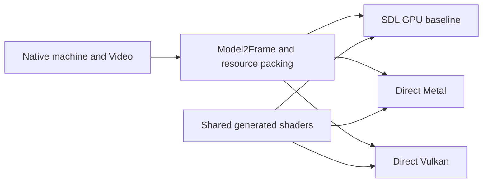

# Direct Metal and Vulkan renderers

The direct backends render the complete Model 2 image offscreen: background
tiles, ordered polygons, foreground tiles and the optional CPU-composed HUD.
They reuse the existing game-facing frame packet, resource packing and shaders.
The Mac player now uses direct Metal for the game, CRT and Settings by default.
SDL3 still supplies its window, input and audio services. The same executable
retains `--sdl-gpu` for comparison. Vulkan game integration remains in progress;
the current Windows/Linux packages use SDL3 GPU.

## Shared rendering contract



`src/app/gpu/model2_frame.*` owns the vertex, edge, scissor and batch data.
`model2_resources.h` supplies texture, luminance, color translation and tile
packing. The direct backends use the unchanged generated MSL and SPIR-V in
`shaders_gen.h`. Accurate textures remains the existing polygon scanline option;
it is separate from CRT presentation scanlines.

Metal's `MetalModel2` encodes into a caller-owned command buffer and render
target. It requires retained command references and copies frame resources so
later CPU changes cannot overwrite an in-flight draw. The caller submits,
presents and handles completion. `MetalCrt` uses the existing generated CRT
shader and also leaves submission and presentation to the caller.

The Mac `MetalPresenter` owns the device, command queue and CAMetalLayer behind
an SDL Metal view. One ordered queue protects the cached game texture, with at
most two pending command buffers. It draws CRT or the original nearest/linear
image, then Settings using the pinned Dear ImGui Metal backend. Integer scaling,
resizing, paused Settings changes and hidden-window game updates preserve the
existing host behavior. Capture drains the queue and reads the image before CRT.
No SDL GPU device or SDL GPU commands are used on this path.

Vulkan's `VulkanModel2` currently owns a device, command buffer and synchronous
offscreen target. It submits, waits and returns BGRA pixels. Vulkan 1.1, depth
clamp and the required image formats are checked; dimensions must match Video
and device limits. Its full snapshots, per-frame pipeline creation and readback
make it a correctness implementation. It needs resource reuse, asynchronous
frame submission and a swapchain before production performance testing.

Both native test executables link without SDL. Separate reference executables
use pinned SDL commit `fa2c02bb6e21974a89ea9824bc53c9932abe5f9c` and the current
production renderer. No translated game code or ROM is needed for synthetic
tests. Optional recorded scenes remain private local build inputs.

## Validation

The shared synthetic matrix covers tile composition, translucent and cutout
polygons, texture variants, scissor/depth ordering, Accurate textures on/off,
scales 1 and 2, widened CPU foreground composition and empty geometry. The
fixture retains polygon storage for the lifetime of Video and explicitly
initializes colored tile pens, so a black or dangling input cannot pass as a
useful image comparison.

Vulkan passed 38 exact image comparisons, totaling 17,547,264 pixels, with zero
Khronos synchronization validation errors. This used lavapipe/Mesa 25.2.8 in a
Linux x86-64 container. Twenty-six images are invented; twelve draw three
preserved game scenes with Accurate textures off/on at scales 1/2. This is
equivalence to SDL on the same software Vulkan driver, not hardware-vendor
coverage, frame pacing or arcade certification.

Metal passed the same 38 image comparisons, also totaling 17,547,264 pixels,
on an Apple M5 with Metal API Validation enabled. At native resolution the
three recorded scenes additionally match preserved SDL output with Accurate
textures off and preserved CPU output with it on. Two unsubmitted command
buffers keep their distinct snapshots after Video mutation and reverse
submission. Direct Metal CRT separately passes 16 exact SDL comparisons and
204 checks. These are bounded offscreen checks, not a full-game speed result.

Actual Mac game integration additionally passes three 2,600-frame driving
runs from fresh saves: SDL Metal, direct Metal and direct Metal with Accurate
textures. Execution, replayed inputs, native PCM and final saves match exactly.
The final direct image equals SDL; the Accurate-textures image equals the
same-machine CPU renderer. These comparisons cover final images, not every
intermediate frame or an independent arcade reference.

A separate visible, paced run presents all 2,100 game frames with fresh sound
and CRT defaults enabled. It produces 1,610,005 stereo PCM frames with zero
chip/host drops or reported device input shortfalls. This measures application
output delivery, not physical speaker fidelity. The presenter fixture passes
55 checks, including 20 real presentations, Settings, filtering, integer scale,
resize, hidden updates and paused texture changes with Metal validation enabled.
The separate Settings fixture passes 91 checks for actual mouse CRT toggles,
persisted preferences, binding isolation, foreign-context handling and switching
between native and SDL rendering within one executable.

The wrappers preserve command output, executable/source hashes and image
comparisons under a new ignored output directory. They verify source and
private input hashes remain unchanged during the run. Failure evidence is kept.
Exact local result identities and retained failure details are recorded in
[HANDOFF.md](../HANDOFF.md).

## Running checks

For Vulkan, install a C++20 toolchain, CMake 3.25+, Vulkan development files,
validation layers and a Vulkan driver. Fetch the pinned SDL reference into
`extern/sdl3`, then run:

```sh
python3 tests/test_native_vulkan_model2.py \
  --output build/native-vulkan-check-001 --require-validation
```

Add `--require-software` when explicitly testing lavapipe. Optional repeated
`--scene /path/to/private/scene` arguments extend the comparisons without
uploading the captured inputs. The dedicated GitHub workflow runs the 26
invented images with lavapipe and synchronization validation.

For actual Metal comparisons, build a static library from the pinned SDL source
and run on a Mac with a usable Metal device:

```sh
python3 tests/test_native_metal_model2.py \
  --sdl-source extern/sdl3 \
  --sdl-library /path/to/libSDL3.a \
  --output build/native-metal-check-001
python3 tests/test_native_metal_crt.py \
  --sdl-include extern/sdl3/include \
  --sdl-library /path/to/libSDL3.a \
  --output build/native-metal-crt-check-001
```

The dedicated Metal CI compiles and links both native fixture clients without
SDL; it does not assume a hosted runner has a Metal GPU. Its build can also be
run locally without fetching SDL or supplying game data:

```sh
cmake -S platform/segarally/native-metal -B build/native-metal-compile \
  -DCMAKE_BUILD_TYPE=Release
cmake --build build/native-metal-compile --parallel 2
```

The window/Settings fixture additionally links the pinned ImGui library with
its SDL3, SDL GPU and Metal backends. Run it on a Mac with a display:

```sh
python3 tests/test_native_metal_presenter.py \
  --sdl-source extern/sdl3 --sdl-library /path/to/libSDL3.a \
  --imgui-source extern/imgui --imgui-library /path/to/libsegarally_imgui.a \
  --output build/native-metal-presenter-check-001
```

Add `--panel` with a new output directory to run the focused Settings fixture.

The dedicated game CMake project enables `SEGARALLY_NATIVE_METAL` on macOS.
Use `--player` for normal sound/CRT startup when passing explicit paths;
`--native-metal` makes the backend selection explicit, and `--sdl-gpu` selects
the existing renderer. Configure `-DSEGARALLY_NATIVE_METAL=OFF` for an SDL-only
Mac build. The option is currently unavailable on iOS and non-Apple systems.
The regular macOS frontend CI compiles the direct player and Settings path
using ROM-free link fixtures; hosted CI does not claim GPU execution.

## Remaining integration

1. Add asynchronous Vulkan frame resources and presentation; measure allocation
   and upload costs for both backends before optimizing shared behavior.
2. Connect Vulkan to the actual game and Settings; replace SDL window services.
3. Replace SDL input, controller and audio services with equivalent lifecycle
   handling, including focus loss, suspend/resume and device changes.
4. Run recorded gameplay and physical audio/controller checks on each platform.
   Full-race MAME/PCB comparisons and hardware precision work remain separate
   fidelity requirements.
