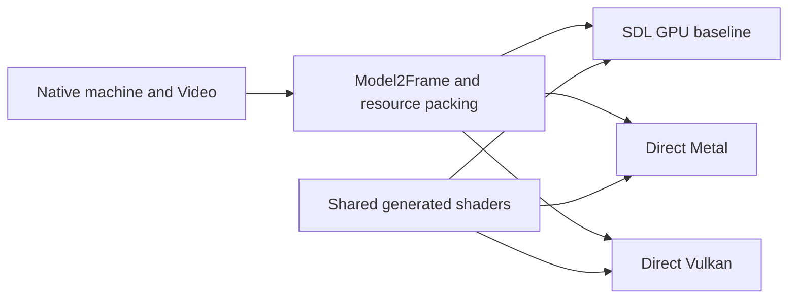

# Direct Metal and Vulkan renderers

The direct backends render the complete Model 2 image offscreen: background
tiles, ordered polygons, foreground tiles and the optional CPU-composed HUD.
They reuse the existing game-facing frame packet, resource packing and shaders.
The Mac player now uses direct Metal for the game, CRT and Settings by default.
SDL3 still supplies its window, input and audio services. The same executable
retains `--sdl-gpu` for comparison. Windows/Linux source builds can additionally
enable the direct Vulkan player with `SEGARALLY_NATIVE_VULKAN=ON` and select it
using `--native-vulkan`. The earlier Windows/Linux packages use SDL3 GPU.

## Shared rendering contract



`src/app/gpu/model2_frame.*` owns the vertex, edge, scissor and batch data.
`model2_resources.h` supplies texture, luminance, color translation and tile
packing. The direct backends use the unchanged generated MSL and SPIR-V in
`shaders_gen.h`. Accurate textures remains the existing polygon scanline option;
it is separate from CRT presentation scanlines.

Metal's `MetalModel2` encodes into a caller-owned command buffer and render
target. It requires retained command references and copies frame resources so
later CPU changes cannot overwrite an in-flight draw. The caller submits,
presents and handles completion. `MetalCrt` uses the existing generated CRT
shader and also leaves submission and presentation to the caller.

The Mac `MetalPresenter` owns the device, command queue and CAMetalLayer behind
an SDL Metal view. One ordered queue protects the cached game texture, with at
most two pending command buffers. It draws CRT or the original nearest/linear
image, then Settings using the pinned Dear ImGui Metal backend. Integer scaling,
resizing, paused Settings changes and hidden-window game updates preserve the
existing host behavior. Capture drains the queue and reads the image before CRT.
No SDL GPU device or SDL GPU commands are used on this path.

Vulkan's `VulkanModel2` owns a device and three fenced frame slots with reusable
buffers, targets and persistent pipelines. It snapshots frame resources,
encodes, permits caller commands, and submits asynchronously. Its diagnostic
`render`/readback API uses the same encoder. Vulkan 1.1, depth clamp, required
image formats and dimensions are checked against Video and device limits.

`VulkanPresenter` uses SDL only to create the window and Vulkan surface. It
owns a FIFO swapchain, image-indexed presentation semaphores, CRT resources and
cached paused frames. CRT-off presentation uses the same native image blit as
the SDL reference, including nearest/linear filtering and integer scaling.
Settings uses the pinned ImGui Vulkan backend after the game presentation.
Its UI buffer count covers both swapchain images and the three command slots;
reconfiguration drains incompatible resources. Resize/minimize and hidden
updates are handled separately from the game clock. Device-loss errors stop
the host; automatic recovery and injected device-loss testing remain open.

Both native test executables link without SDL. Separate reference executables
use pinned SDL commit `fa2c02bb6e21974a89ea9824bc53c9932abe5f9c` and the current
production renderer. No translated game code or ROM is needed for synthetic
tests. Optional recorded scenes remain private local build inputs.

## Validation

The shared synthetic matrix covers tile composition, translucent and cutout
polygons, texture variants, scissor/depth ordering, Accurate textures on/off,
scales 1 and 2, widened CPU foreground composition and empty geometry. The
fixture retains polygon storage for the lifetime of Video and explicitly
initializes colored tile pens, so a black or dangling input cannot pass as a
useful image comparison.

Vulkan passed 38 exact image comparisons, totaling 17,547,264 pixels, with zero
Khronos synchronization validation errors. This used lavapipe/Mesa 25.2.8 in a
Linux x86-64 container. Twenty-six images are invented; twelve draw three
preserved game scenes with Accurate textures off/on at scales 1/2. This is
equivalence to SDL on the same software Vulkan driver, not hardware-vendor
coverage, frame pacing or arcade certification.

Metal passed the same 38 image comparisons, also totaling 17,547,264 pixels,
on an Apple M5 with Metal API Validation enabled. At native resolution the
three recorded scenes additionally match preserved SDL output with Accurate
textures off and preserved CPU output with it on. Two unsubmitted command
buffers keep their distinct snapshots after Video mutation and reverse
submission. Direct Metal CRT separately passes 16 exact SDL comparisons and
204 checks. These are bounded offscreen checks, not a full-game speed result.

Actual Mac game integration additionally passes three 2,600-frame driving
runs from fresh saves: SDL Metal, direct Metal and direct Metal with Accurate
textures. Execution, replayed inputs, native PCM and final saves match exactly.
The final direct image equals SDL; the Accurate-textures image equals the
same-machine CPU renderer. These comparisons cover final images, not every
intermediate frame or an independent arcade reference.

A separate visible, paced run presents all 2,100 game frames with fresh sound
and CRT defaults enabled. It produces 1,610,005 stereo PCM frames with zero
chip/host drops or reported device input shortfalls. This measures application
output delivery, not physical speaker fidelity. The presenter fixture passes
55 checks, including 20 real presentations, Settings, filtering, integer scale,
resize, hidden updates and paused texture changes with Metal validation enabled.
The separate Settings fixture passes 91 checks for actual mouse CRT toggles,
persisted preferences, binding isolation, foreign-context handling and switching
between native and SDL rendering within one executable.

The asynchronous Vulkan implementation repeats all 38 offscreen image
comparisons exactly. Three deliberately pending submissions retain their
images after CPU inputs are mutated or destroyed. Window tests exercise 101
presentations, four swapchains, resize/minimize/restore, cached frames, hidden
updates and overlays, with zero synchronization errors. Steady frames do not
recreate pipelines, allocate renderer resources or wait for the entire device.
This establishes resource reuse, not performance on a hardware GPU.

Four actual X11 window comparisons cover odd and downscaled output sizes with
nearest and linear filtering: all 538,020 pixels equal SDL Vulkan. The Settings
fixture passes 304 checks, including mouse CRT toggles, preferences, binding
isolation, queued UI frames, resize and native/SDL transitions. These Vulkan
checks run on lavapipe in a Linux container; Windows and vendor-GPU execution
remain separate requirements.

The actual Linux game additionally passes three visible 2,600-frame driving
runs: SDL Vulkan, direct Vulkan and direct Vulkan with Accurate textures.
Execution, native PCM, inputs, recordings and final saves are identical. Each
direct arm presents all 2,600 frames with one swapchain, four Model 2 pipelines,
one CRT pipeline and zero validation errors. The final default image equals
SDL Vulkan; Accurate textures equals the same-machine CPU reference. These
unthrottled runs capture/drain audio without physical playback.

Default images are not claimed identical across graphics APIs. An exact-scene
experiment reproduces the preserved SDL Vulkan/Linux versus SDL Metal/Mac
final-image discrepancy: 951 of 190,464 pixels differ. The frame is exported
after the 2,600-frame replay, at 500,035,460 instructions, 1,130,001,001 reference
cycles and PC `0x005e6964`, then reconstructed independently on Apple M5 Metal
and Linux lavapipe. Both offscreen images reproduce their respective game
captures. All 8,526 projected vertices and both CPU images are byte-identical,
which excludes host projection and CPU raster differences for this scene.

The exporter also reproduces native PCM, input observations, final saves and
all actual resume records. Instrumenting the executable changes its recording
identity, so manifest/context and transcript hashes differ; those identity
fields are distinguished from the unchanged execution records.

Diagnostic outputs retain the same surviving polygon at 940 of the differing
pixels. Every one of those 940 pixels has a different integer U or V coordinate
and a different sampled texel. The other 11 pixels change surviving polygon,
and every case involves a cutout texture. This localizes the discrepancy to the
default GPU projection/interpolation and texture sampling path; it does not yet
separate vertex arithmetic from raster interpolation, or edge coverage from
cutout thresholds at those 11 pixels. No renderer default or shader correction
is justified by this attribution alone.

Against the identical CPU image, default Metal differs at 21,062 pixels and
default Vulkan at 20,644. Among the 951 cross-API differences, Metal agrees with
CPU at 241, Vulkan at 659, and neither at 51. The unmodified Accurate-textures
outputs are identical across APIs and equal CPU for this frame. That optional
path is a separate result, not a correction to the default path.

Eight Accurate-mode **diagnostic** draws are rejected: dead-code elimination
removes unused luma/translation buffers, and SPIRV-Cross compacts Metal's edge
buffer binding. Default diagnostic packets have zero edge metadata and never
read that buffer; only those default draws contribute to attribution. The
unmodified production Accurate comparisons above remain valid. The rejected
draws and initial analysis are retained, not counted as passing comparisons.

The local report is
`build/worktrees/rc-raster-001/build/cross-api-001/result.json`, SHA256
`a525657551cde68020edf78d0fee7e24ab1ee3d52a2c7b481130844801ff1d9e`.
It records 170 source hashes and 262 rechecked artifact hashes. Game snapshots,
shader instrumentation and captures remain local ignored evidence. This is one
frame's attribution, not temporal-flicker coverage, a performance result or an
independent arcade reference. Full-race requirements remain in the binding
[Reference & validation](daytona-usa-recomp-design.md#reference--validation)
section; player build checks are described in the
[build and validation guide](segarally-build-validation.md).

The wrappers preserve command output, executable/source hashes and image
comparisons under a new ignored output directory. They verify source and
private input hashes remain unchanged during the run. Failure evidence is kept.
Exact local result identities and retained failure details are recorded in
[HANDOFF.md](../HANDOFF.md).

## Running checks

For Vulkan, install a C++20 toolchain, CMake 3.25+, Vulkan development files,
validation layers and a Vulkan driver. Fetch the pinned SDL reference into
`extern/sdl3`, then run:

```sh
python3 tests/test_native_vulkan_model2.py \
  --output build/native-vulkan-check-001 --require-validation
```

Add `--require-software` when explicitly testing lavapipe. Optional repeated
`--scene /path/to/private/scene` arguments extend the comparisons without
uploading the captured inputs. The dedicated GitHub workflow runs the 26
invented images with lavapipe and synchronization validation.

For actual Metal comparisons, build a static library from the pinned SDL source
and run on a Mac with a usable Metal device:

```sh
python3 tests/test_native_metal_model2.py \
  --sdl-source extern/sdl3 \
  --sdl-library /path/to/libSDL3.a \
  --output build/native-metal-check-001
python3 tests/test_native_metal_crt.py \
  --sdl-include extern/sdl3/include \
  --sdl-library /path/to/libSDL3.a \
  --output build/native-metal-crt-check-001
```

The dedicated Metal CI compiles and links both native fixture clients without
SDL; it does not assume a hosted runner has a Metal GPU. Its build can also be
run locally without fetching SDL or supplying game data:

```sh
cmake -S platform/segarally/native-metal -B build/native-metal-compile \
  -DCMAKE_BUILD_TYPE=Release
cmake --build build/native-metal-compile --parallel 2
```

The window/Settings fixture additionally links the pinned ImGui library with
its SDL3, SDL GPU and Metal backends. Run it on a Mac with a display:

```sh
python3 tests/test_native_metal_presenter.py \
  --sdl-source extern/sdl3 --sdl-library /path/to/libSDL3.a \
  --imgui-source extern/imgui --imgui-library /path/to/libsegarally_imgui.a \
  --output build/native-metal-presenter-check-001
```

Add `--panel` with a new output directory to run the focused Settings fixture.

The dedicated game CMake project enables `SEGARALLY_NATIVE_METAL` on macOS.
Use `--player` for normal sound/CRT startup when passing explicit paths;
`--native-metal` makes the backend selection explicit, and `--sdl-gpu` selects
the existing renderer. Configure `-DSEGARALLY_NATIVE_METAL=OFF` for an SDL-only
Mac build. The option is currently unavailable on iOS and non-Apple systems.
The regular macOS frontend CI compiles the direct player and Settings path
using ROM-free link fixtures; hosted CI does not claim GPU execution.

For the Windows/Linux game build, add `-DSEGARALLY_NATIVE_VULKAN=ON` to the
dedicated host configuration in the [build guide](segarally-build-validation.md).
This requires Vulkan development headers and the loader library. Run
`segarally_native --player --native-vulkan` to select it; SDL GPU remains the
Windows/Linux default. Add `--vulkan-validation` only when the Khronos
validation layer is installed. Both renderers remain in the same executable.

On Linux, the extra X11 fixtures can be built explicitly:

```sh
cmake --build /path/to/host-build --target test_native_vulkan_blit test_segarally_display_vulkan
python3 tests/test_native_vulkan_blit.py \
  --executable /path/to/host-build/test_native_vulkan_blit \
  --output build/native-vulkan-blit-check-001
python3 tests/test_native_vulkan_player.py \
  --executable /path/to/host-build/segarally_native --data /path/to/owned/assets \
  --visible --output build/native-vulkan-game-check-001
```

The game check requires locally generated game code and verified owner data;
its outputs remain private. Use `xvfb-run -a` around that command on headless
Linux. CI instead compiles the full Vulkan host and
Settings using original ROM-free link fixtures on Linux GCC and Clang. The
separate Vulkan workflows execute invented render/presentation fixtures with
lavapipe, never uploaded game data.

Native Wayland has a separate Linux fixture. Install Weston, Wayland development
files/protocols, xkbcommon and EGL development files alongside the Vulkan
dependencies. Pinned SDL requires EGL to enable its Wayland window backend even
when this fixture renders through Vulkan. Pass the
installed lavapipe ICD explicitly:

```sh
python3 tests/test_native_vulkan_wayland.py \
  --icd /path/to/lvp_icd.json --output build/native-vulkan-wayland-check-001
```

This builds pinned SDL with Wayland enabled and both X11 and SDL GPU disabled.
It starts a private headless Weston compositor and exercises the direct Vulkan
presenter with original synthetic scenes. The check covers cached-frame pause,
an offscreen update while hidden, restoration at the same size, three resizes
and overlay submissions. The local run passes 110 checks, 68 presentations and
zero Vulkan validation errors; four Model 2 pipelines and one CRT pipeline
persist across five swapchains. Captures are raw offscreen images, not compositor
screenshots or evidence of physical display/input/audio behavior.

This regression exposed a hang in `vkQueuePresentKHR` after restoring a hidden
window without changing its size. The presenter now marks the swapchain stale
while hidden, minimized or zero-sized, then retires it through the existing
drain/device-idle path before resuming. Unmapping can leave FIFO presentation
state unusable even when the dimensions still match. The shared game image and
pipelines survive this transition. The original timeout and instrumented
diagnosis are retained alongside the passing uninstrumented result at
`build/worktrees/rc-platform-readiness-001/build/wayland-check-005/result.json`,
SHA256 `79b14cec55927bed33c0e96e7026d21f6677d5cfdd9df2d34eadda8a4ae8183e`.
The dedicated workflow runs this regression separately from X11. Preview 3's
published Linux player remains X11-only; this fixture does not add native
Wayland support to that already published binary.

## Remaining integration

1. Validate Vulkan gameplay and physical GPUs on supported Windows/Linux systems;
   measure upload costs and pacing before optimizing shared behavior.
2. Replace SDL window services while preserving presentation and Settings.
3. Replace SDL input, controller and audio services with equivalent lifecycle
   handling, including focus loss, suspend/resume and device changes.
4. Run recorded gameplay and physical audio/controller checks on each platform.
   Full-race MAME/PCB comparisons and hardware precision work remain separate
   fidelity requirements.
