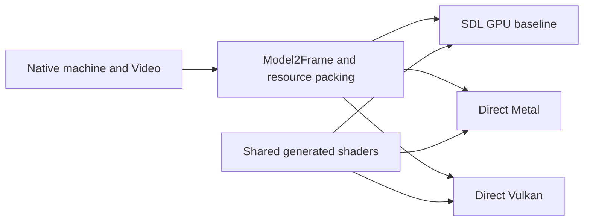

# Direct Metal and Vulkan renderers

The direct backends render the complete Model 2 image offscreen: background
tiles, ordered polygons, foreground tiles and the optional CPU-composed HUD.
They reuse the existing game-facing frame packet, resource packing and shaders.
The playable apps still use SDL3; these backends are the tested starting point
for replacing its graphics duties. Window presentation, Settings, input and
audio require separate host integration.

## Shared rendering contract



`src/app/gpu/model2_frame.*` owns the vertex, edge, scissor and batch data.
`model2_resources.h` supplies texture, luminance, color translation and tile
packing. The direct backends use the unchanged generated MSL and SPIR-V in
`shaders_gen.h`. Accurate textures remains the existing polygon scanline option;
it is separate from CRT presentation scanlines.

Metal's `MetalModel2` encodes into a caller-owned command buffer and render
target. It requires retained command references and copies frame resources so
later CPU changes cannot overwrite an in-flight draw. The caller submits,
presents and handles completion. `MetalCrt` uses the existing generated CRT
shader and also leaves submission and presentation to the caller.

Vulkan's `VulkanModel2` currently owns a device, command buffer and synchronous
offscreen target. It submits, waits and returns BGRA pixels. Vulkan 1.1, depth
clamp and the required image formats are checked; dimensions must match Video
and device limits. Its full snapshots, per-frame pipeline creation and readback
make it a correctness implementation. It needs resource reuse, asynchronous
frame submission and a swapchain before production performance testing.

Both native test executables link without SDL. Separate reference executables
use pinned SDL commit `fa2c02bb6e21974a89ea9824bc53c9932abe5f9c` and the current
production renderer. No translated game code or ROM is needed for synthetic
tests. Optional recorded scenes remain private local build inputs.

## Validation

The shared synthetic matrix covers tile composition, translucent and cutout
polygons, texture variants, scissor/depth ordering, Accurate textures on/off,
scales 1 and 2, widened CPU foreground composition and empty geometry. The
fixture retains polygon storage for the lifetime of Video and explicitly
initializes colored tile pens, so a black or dangling input cannot pass as a
useful image comparison.

Vulkan passed 38 exact image comparisons, totaling 17,547,264 pixels, with zero
Khronos synchronization validation errors. This used lavapipe/Mesa 25.2.8 in a
Linux x86-64 container. Twenty-six images are invented; twelve draw three
preserved game scenes with Accurate textures off/on at scales 1/2. This is
equivalence to SDL on the same software Vulkan driver, not hardware-vendor
coverage, frame pacing or arcade certification.

Metal passed the same 38 image comparisons, also totaling 17,547,264 pixels,
on an Apple M5 with Metal API Validation enabled. At native resolution the
three recorded scenes additionally match preserved SDL output with Accurate
textures off and preserved CPU output with it on. Two unsubmitted command
buffers keep their distinct snapshots after Video mutation and reverse
submission. Direct Metal CRT separately passes 16 exact SDL comparisons and
204 checks. These are bounded offscreen checks, not a full-game speed result.

The wrappers preserve command output, executable/source hashes and image
comparisons under a new ignored output directory. They verify source and
private input hashes remain unchanged during the run. Failure evidence is kept.
Exact local result identities and retained failure details are recorded in
[HANDOFF.md](../HANDOFF.md).

## Running checks

For Vulkan, install a C++20 toolchain, CMake 3.25+, Vulkan development files,
validation layers and a Vulkan driver. Fetch the pinned SDL reference into
`extern/sdl3`, then run:

```sh
python3 tests/test_native_vulkan_model2.py \
  --output build/native-vulkan-check-001 --require-validation
```

Add `--require-software` when explicitly testing lavapipe. Optional repeated
`--scene /path/to/private/scene` arguments extend the comparisons without
uploading the captured inputs. The dedicated GitHub workflow runs the 26
invented images with lavapipe and synchronization validation.

For actual Metal comparisons, build a static library from the pinned SDL source
and run on a Mac with a usable Metal device:

```sh
python3 tests/test_native_metal_model2.py \
  --sdl-source extern/sdl3 \
  --sdl-library /path/to/libSDL3.a \
  --output build/native-metal-check-001
python3 tests/test_native_metal_crt.py \
  --sdl-include extern/sdl3/include \
  --sdl-library /path/to/libSDL3.a \
  --output build/native-metal-crt-check-001
```

The dedicated Metal CI compiles and links both native fixture clients without
SDL; it does not assume a hosted runner has a Metal GPU. Its build can also be
run locally without fetching SDL or supplying game data:

```sh
cmake -S platform/segarally/native-metal -B build/native-metal-compile \
  -DCMAKE_BUILD_TYPE=Release
cmake --build build/native-metal-compile --parallel 2
```

## Remaining integration

1. Add asynchronous Vulkan frame resources and presentation; measure allocation
   and upload costs for both backends before optimizing shared behavior.
2. Connect the verified rendering path and CRT to native windows and Settings.
3. Replace SDL input, controller and audio services with equivalent lifecycle
   handling, including focus loss, suspend/resume and device changes.
4. Run recorded gameplay and physical audio/controller checks on each platform.
   Full-race MAME/PCB comparisons and hardware precision work remain separate
   fidelity requirements.
