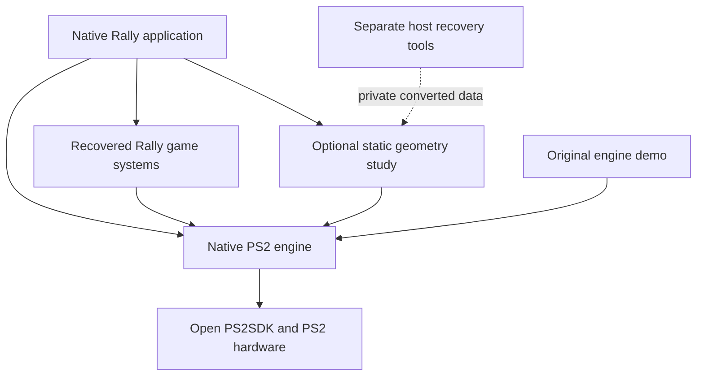

# Reusable native PS2 engine

The PS2 work is a reusable native engine with Sega Rally as one consumer.
Games own their rules, simulation, cameras and assets. The engine owns direct
PS2 service implementations and explicit rendering/data contracts. The arcade
reference machine and offline recovery tools remain separate executables.
This follows the native-runtime exception in the design document's
[Platform layer & build](daytona-usa-recomp-design.md#platform-layer--build).

This is an experimental engine foundation, not a finished general-purpose SDK.
Its current restrictions are recorded below. Reuse must preserve the validated
hardware behavior and keep ownership and memory costs visible to applications.

## Dependency direction



The source-role inventory in `platform/ps2/build_ps2.py` enforces these project
dependencies before compilation. Every translation unit and project header is
checked separately, including indirect dependencies and files that the linker
might later discard. A folder name alone does not confer permission.

| Role | Current files | Permitted project dependencies |
| --- | --- | --- |
| Engine | Native display, frame validation, clipping, VU0 packing, pad hardware, storage, PCM transport and IOP module | Explicit engine inventory only |
| Rally game | Recovered progress, pose, angle-fold, both orientation contracts, direction blend, contact neighborhood/projection/search and cabinet steering/filter | Own game role and engine |
| Geometry study | `native_mesh`, `native_scene`, captured-view transforms and fitted camera | Own study role and engine |
| Rally application | `platform/ps2/native/main.cpp` | Rally game, study and engine |
| Original demo | `platform/ps2/samples/engine_demo/main.cpp` | Demo and engine |
| Offline recovery/reference | Capture, source-link decoding, converters, behavioral oracles and translated machine | Never a dependency of a native engine/application target |

Keep semantic functions such as Rally's angle fold in the game role even when
their names sound like reusable mathematics. Their arithmetic and domains come
from game behavior. Conversely, an original bounded homogeneous clipper belongs
to the engine because its contract is independent of any game's camera.

Files initially stay in their existing locations to preserve working build and
validation paths. Roles, dependency checks and a second consumer establish the
boundary. Future moves must retain those checks and evidence; renaming folders
alone does not establish independence.

SDK and standard-library dependencies are external to this project-file gate.
Application entry points still call SDK startup, clock and sleep functions
directly. The gate is a reproducible project dependency check, not a general
proof that application code cannot access hardware or an external library.

## Proving a second application

The `engine-demo` target builds original geometry and optional original tone
output with the same engine sources. It requires no Rally leaves, captured
meshes, arcade asset packs, generated processor programs or converted game data.
Both native applications record the shared engine source identity in their
build reports; application-specific files remain separate.

```sh
python3 platform/ps2/build_ps2.py smoke --target engine-demo \
  --output build/ps2-engine-demo
python3 platform/ps2/build_ps2.py build --target engine-demo \
  --output build/ps2-engine-demo --jobs 4
```

The output is `build/ps2-engine-demo/ps2-engine-demo.elf`. Cross-compilation and
source identity prove the dependency arrangement. Emulator rendering, controller
behavior, audible output and physical-console performance are separate checks.
The PS2 CI workflow builds both applications and runs boundary tests without
providing any game data.

The 2026-10-24 checkpoint also executed both applications in Play 0.72 using
its built-in HLE. The independent demo displayed its original animated cube;
the Rally study submitted 1,040 static car triangles. Their build reports share
the same 21 engine input hashes. A separate renderer fixture passed 464 checks,
including 24 injected initialization failures and 320 GS pixel samples for
ownership, cache invalidation and replacement. A full 640 by 448 RGB readback
of the private car study remained byte-identical to the preceding renderer.
All 94 portable PS2 tests passed. These bounded emulator checks do not establish
physical-console performance, interactive controller behavior or audible output.
Fatal reverse-transfer quarantine was reviewed but not fault-injected.

The subsequent native-game recovery checkpoint passes 138 portable PS2 tests
and adds five standalone EE fixtures. Its 48-file native application audit
passes while the same 21 engine input hashes remain unchanged. Steering,
orientation and course-contact semantics stay in the game role; the new
components are not yet connected to driving gameplay.

To start another game, add its own application and typed game-state modules,
register their explicit source/header role and link the shared engine inventory.
Keep its input mapping, simulation cadence, camera, resource lifetime and data
conversion in that game's code. A new game does not inherit permission to import
Rally internals or an arcade device model. Add a test that rejects that direction.

## Ownership and execution contracts

| Resource | Owner and current contract |
| --- | --- |
| GS, GIF and VRAM | One active Display controls the framebuffer, depth allocation and texture/CLUT cache. Presentation consumes ordered native triangles synchronously. |
| Draw buffers | Applications retain triangles, materials and texture bytes through `present()`. The display does not own game objects or asset allocations. |
| Texture identity | Pointer, dimensions and generation identify cached content. Change the generation after editing, or explicitly invalidate the texture cache before allocation identity is reused. |
| VU0 | The render thread owns macro-mode packing for the complete synchronous call. No overlapping microprogram or other VU0 user is permitted. |
| VU1/VIF1 | Production VU1 geometry is not integrated. Diagnostic readback requires exclusive idle ownership, including no future XGKICK producer. |
| IOP | Application startup chooses reset ownership once before opening dependent services. Preserve loader modules when using its host filesystem. |
| Pad | A nonmovable PadInput retains its DMA buffer until the port closes. Physical controller state is mapped to game actions by the application. |
| Audio | One application-owned PCM stream; initialize after the final IOP reset and pad/storage setup. Submitted data is consumed/copied synchronously. |
| Storage | Initialize after the final IOP reset and before opening USB files. Never reset IOP underneath open files or active audio/pad services. |

Applications serialize hardware-service calls on their owning thread. These
interfaces do not promise thread-safe concurrent initialization or submission.

The GS path retains native indexed textures, CLUTs, explicit primitive order,
optional Z16S depth and visible cache/transfer counters. It does not hide these
behind a desktop-style graphics API or reorder primitive work for convenience.
Normal presentation waits for completion. Diagnostic readback adds explicit
timeouts and retires the display after an incomplete reverse transfer; that
failure policy is not a universal device-recovery system.

Memory and work limits are part of the contract. The clipper uses fixed scratch
storage and transactional output. Display submission caps at 16,384 triangles;
PSMT4 texture dimensions are powers of two from 8 through 256 per axis. Its
transfer staging buffer is 64 KiB. The display allocates bounded VRAM/cache and
transfer buffers. Games choose asset lifetimes and frame storage; there is no
implicit entity store, task scheduler or per-object allocation policy.

## Current limits and next architectural work

- Materials currently support opaque and cutout drawing; general alpha blending
  is not implemented.
- The logical viewport remains 496 by 384, shared by validation, clipping and
  display scaling. Introduce one validated viewport configuration with this as
  the compatibility default; do not change only one of those consumers.
- Controller snapshots expose a limited button set and the left horizontal
  axis. The neutral `left_x` name separates physical state from steering, but
  full axes/buttons and per-game action mapping still need expansion.
- Audio currently accepts 44.1 kHz stereo floats and produces 48 kHz PCM through
  the tested resampler. A direct native-rate transport and optional conversion
  adapter are future work. Existing protocol names do not imply arcade sound
  synthesis; the service streams PCM.
- Startup order is explicit but not yet owned by a single reusable hardware
  session object. Pad initialization can reset the IOP, and storage remembers
  module loading globally. Repeated sessions, hot switching between games and
  reset recovery are unsupported until this lifecycle is centralized and tested.
- Ordinary GS waits and synchronous SDK audio RPC do not have universal
  deadlines. Do not advertise bounded frame latency or recovery from every
  device failure.
- `RLYMESH` version one and `object_to_reference_view` describe captured study
  data. Keep them in the study adapter. A general world-space mesh/material
  format requires its own explicit coordinate, version and lifetime contracts.
- The EE clipper is a correctness reference using software-double operations.
  Move measured work to VU kernels only with numerical comparisons, complete
  bank/transfer budgets and synchronized ownership. VU experiments alone do not
  establish production throughput.

Further abstraction should follow another real consumer. A scene graph, entity
system, plugin loader or general scheduler is not required to share the current
services. The next extraction should solve an observed game requirement without
changing Rally's recovered behavior or conflating diagnostic output with gameplay.
