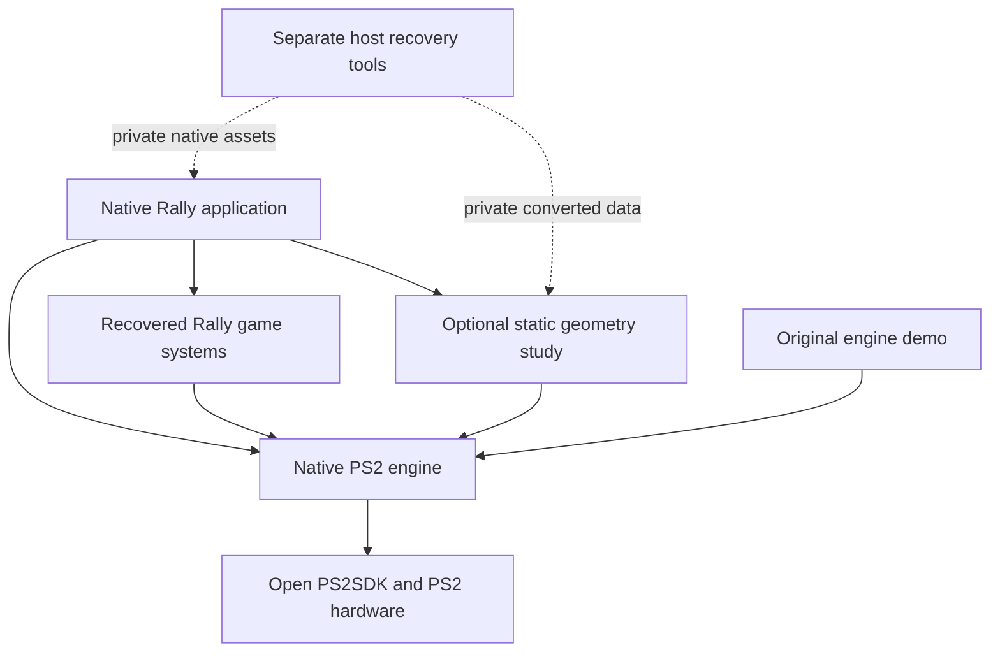
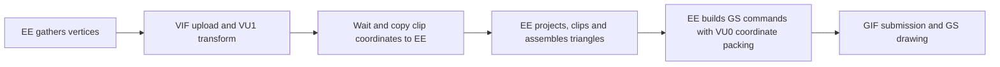

# Reusable native PS2 engine

The PS2 work is a reusable native engine with Sega Rally as one consumer.
Games own their rules, simulation, cameras and assets. The engine owns direct
PS2 service implementations and explicit rendering/data contracts. The arcade
reference machine and offline recovery tools remain separate executables.
This follows the native-runtime exception in the design document's
[Platform layer & build](daytona-usa-recomp-design.md#platform-layer--build).

This is an experimental engine foundation, not a finished general-purpose SDK.
Its current restrictions are recorded below. Reuse must preserve the validated
hardware behavior and keep ownership and memory costs visible to applications.

## Dependency direction



The source-role inventory in `platform/ps2/build_ps2.py` enforces these project
dependencies before compilation. Every translation unit and project header is
checked separately, including indirect dependencies and files that the linker
might later discard. A folder name alone does not confer permission.

| Role | Current files | Permitted project dependencies |
| --- | --- | --- |
| Engine | Native display, page-based texture cache, frame validation, world scene/draw plans, owned textured models, clipping, VU0 packing, VU1 transforms/direct GS packets, pad hardware, storage, PCM transport and IOP module | Explicit engine inventory only |
| Rally game | Recovered main car update, contact/course rules, camera and model assembly, visual adapter and cabinet steering/filter | Own game role and engine |
| Geometry study | `native_mesh`, `native_scene`, captured-view transforms and fitted camera | Own study role and engine |
| Rally application | `platform/ps2/native/main.cpp` | Rally game, study and engine |
| Original demo | `platform/ps2/samples/engine_demo/main.cpp` | Demo and engine |
| Offline recovery/reference | Capture, source-link decoding, converters, behavioral oracles and translated machine | Never a dependency of a native engine/application target |

Keep semantic functions such as Rally's angle fold in the game role even when
their names sound like reusable mathematics. Their arithmetic and domains come
from game behavior. Conversely, an original bounded homogeneous clipper belongs
to the engine because its contract is independent of any game's camera.

Files initially stay in their existing locations to preserve working build and
validation paths. Roles, dependency checks and a second consumer establish the
boundary. Future moves must retain those checks and evidence; renaming folders
alone does not establish independence.

The textured motion path preserves this division. `TexturedModel` owns generic
vertices, per-corner UVs, materials and PSMT4 indices; it contains no arcade
addresses or captured camera matrices. `PreparedWorldModel` validates and owns
immutable geometry/material storage, and published frames retain that storage
through bounded leases. Rally's `RallyVisualScene` chooses course/car/wheel
instances and supplies recovered transforms. The shared engine does not know
which instance is a road, shadow or wheel.

GS texture storage uses 96 complete 8 KiB pages with bounded LRU eviction and
generation-aware identities. Images occupy one, two or four pages according
to their dimensions; the existing completion fence protects every overwrite.
The allocation is 3,751,936 bytes in the NTSC layout and 4,161,536 bytes in PAL,
including both framebuffers, depth, font and CLUT storage. NTSC readback fixtures
validate mixed sizes, residency, eviction, invalidation, cutouts and checker
masks. PAL has a checked memory budget but no new execution result. These
calls remain serialized. The optional direct world path separates GIF stream
retirement from GS drawing completion, so resident batches can leave drawing
queued until a resource-overwrite or frame boundary. This does not establish
overlapping VIF transfers and VU execution or simultaneous use of both VUs.

### Direct world submission

The optional [ordered world renderer](../platform/ps2/native/vu1_world.md)
accepts immutable model geometry instead of a projected EE triangle array:

```text
EE game/camera -> ordered WorldDrawPlan -> VIF1 -> VU1 prepare
                                                      |
                                  +-------------------+------------------+
                                  | ready                                | clip
                                  v                                      v
                         retained VU ST/XYZ                       EE ordered clip
                                  |                                      |
                         EE texture/CLUT residency                 surviving fans
                                  |                                      |
                         VIF1 state -> VU1 emit                   VU0 XY / PATH3
                                  |                                      |
                                PATH1 ---------------------------------> GS
                                                                         |
                                                   resource/flip fence <- FINISH
```

VU1 performs the two transforms, whole-batch admission, projection and packet
packing. Its exact Z16 conversion is separate from the measured binary32
projection policy. Mixed materials retain source order and per-corner UVs;
unsupported batches emit no prefix before the existing clipper takes over.
The single VIF1 owner manages two bounded VU banks and persistent CPU staging.
Display owns resource residency, GS state, failure quarantine and presentation.
Generic authored fixtures exercise this interface without Rally data; the PS2
CI cross-links the fixture, while execution/pixel proofs remain separate.

`WorldSubmissionMode::classify_first` separates geometry preparation from
material residency. Preparation emits no GS packet. A ready result retains
projected ST/XYZ in VU memory behind a single-use token while Display resolves
the batch's textures and palettes through PATH3. Emit supplies fresh state and colors, then
kicks that retained packet. A clipping result returns clip coordinates before
any source-face texture preload; only emitted fallback fans request materials.
If a ready batch cannot be submitted, cancellation retrieves its retained clip
coordinates for the same ordered fallback. The resource-first `fused` mode
remains available as the comparison path.

Tokens belong to one exclusive VU owner and one preparation. Copies cannot
extend their lifetime, and another transform, draw or prepare attempt
invalidates them. Texture transfers between prepare and emit are permitted
under Display's ownership; another VU/VIF producer is not. VU, VIF and GIF must
all be idle before the EE reads mapped VU memory. This split avoids unnecessary
resource work but still uses synchronous handoffs; it does not claim DMA/VU
overlap or a measured speed improvement by itself.

SDK and standard-library dependencies are external to this project-file gate.
Application entry points still call SDK startup, clock and sleep functions
directly. The gate is a reproducible project dependency check, not a general
proof that application code cannot access hardware or an external library.

## Proving a second application

The `engine-demo` target builds original geometry and optional original tone
output with the same engine sources. It requires no Rally leaves, captured
meshes, arcade asset packs, generated processor programs or converted game data.
Both native applications record the shared engine source identity in their
build reports; application-specific files remain separate.

```sh
python3 platform/ps2/build_ps2.py smoke --target engine-demo \
  --output build/ps2-engine-demo
python3 platform/ps2/build_ps2.py build --target engine-demo \
  --output build/ps2-engine-demo --jobs 4
```

The output is `build/ps2-engine-demo/ps2-engine-demo.elf`. Cross-compilation and
source identity prove the dependency arrangement. Emulator rendering, controller
behavior, audible output and physical-console performance are separate checks.
The PS2 CI workflow builds both applications and runs boundary tests without
providing any game data.

The 2026-10-24 checkpoint also executed both applications in Play 0.72 using
its built-in HLE. The independent demo displayed its original animated cube;
the Rally study submitted 1,040 static car triangles. Their build reports share
the same 21 engine input hashes. A separate renderer fixture passed 464 checks,
including 24 injected initialization failures and 320 GS pixel samples for
ownership, cache invalidation and replacement. A full 640 by 448 RGB readback
of the private car study remained byte-identical to the preceding renderer.
All 94 portable PS2 tests passed. These bounded emulator checks do not establish
physical-console performance, interactive controller behavior or audible output.
Fatal reverse-transfer quarantine was reviewed but not fault-injected.

Early native-game recovery added standalone EE fixtures for steering,
orientation, course contact, point transforms and contact-result interpretation.
The native application passes its source-boundary audit while the same 21
engine input hashes remain unchanged. These recovered semantics stay
in the game role; the later developer vehicle driver connects the recovered
main update to live native rendering. The latest
test counts and source-bound evidence are recorded in `HANDOFF.md` and the
[native rewrite guide](ps2-native-rewrite.md).

To start another game, add its own application and typed game-state modules,
register their explicit source/header role and link the shared engine inventory.
Keep its input mapping, simulation cadence, camera, resource lifetime and data
conversion in that game's code. A new game does not inherit permission to import
Rally internals or an arcade device model. Add a test that rejects that direction.

## Ownership and execution contracts

| Resource | Owner and current contract |
| --- | --- |
| GS, GIF and VRAM | One active Display controls the framebuffer, depth allocation and texture/CLUT cache. Presentation consumes ordered native triangles synchronously. |
| Draw buffers | Applications retain triangles, materials and texture bytes through `present()`. The display does not own game objects or asset allocations. |
| Texture identity | Pointer, dimensions and generation identify cached content. Change the generation after editing, or explicitly invalidate the texture cache before allocation identity is reused. |
| VU0 | The render thread owns macro-mode packing for the complete synchronous call. No overlapping microprogram or other VU0 user is permitted. |
| VU1/VIF1 | One exclusive transform owner submits bounded batches, fences VU execution and retires DMA before returning. Failure quarantines transport. GS readback must occur between completed calls, with no future XGKICK producer. |
| IOP | Application startup chooses reset ownership once before opening dependent services. Preserve loader modules when using its host filesystem. |
| Pad | A nonmovable PadInput retains its DMA buffer until the port closes. Physical controller state is mapped to game actions by the application. |
| Audio | One application-owned PCM stream; initialize after the final IOP reset and pad/storage setup. Submitted data is consumed/copied synchronously. |
| Storage | Initialize after the final IOP reset and before opening USB files. Never reset IOP underneath open files or active audio/pad services. |

Applications serialize hardware-service calls on their owning thread. These
interfaces do not promise thread-safe concurrent initialization or submission.

The [VU1 transform backend](../platform/ps2/vu1_transform.md) accepts generic
matrices and vertices, with no Rally state or asset dependencies. WorldScene's
optional batch provider preserves the exact scalar path and owns no hardware.
An optional transform-and-projection provider also returns logical screen X/Y,
depth and reciprocal W while retaining clip coordinates for EE fallback. It is
used only in native-float presentation; reference mode ignores that provider.
The vehicle application's default remains the transform-only provider because
the measured integrated projection continuation is slower.
The vehicle application selects native binary32 presentation by default, with
exact and guarded modes available for comparison. Its game update retains
separate exact arithmetic. VU1 and VU0 currently execute
in sequence, so both being active does not establish overlapped work.

Static geometry can use `PreparedWorldModel`, an owned immutable snapshot that
validates vertices, faces and group coverage and constructs local group bounds
once at load time. Replacement is atomic. `update_prepared` still validates
each instance transform, owner and combined scene capacity; mutable callers
retain the fully checked `update` entry point. Both paths share rendering and
output contracts, allocate nothing per update, and publish frame-owned output.
Rally releases its temporary decoded geometry after preparing body and course
models. Preparation cost and persistent storage belong to asset loading, not
the frame budget.

The bounded vertex cache also retains successfully validated inside projections.
Their lifetime is one instance update; clipped or failed projections use the
full clipper. The internal helper contract preserves projection order,
degenerate-triangle rejection and atomic capacity failures. This adds 24 bytes
per cache entry, at most 96 KiB, for a maximum 224 KiB vertex cache. A separate
2 KiB generation-stamped batch lookup preserves first-occurrence vertex order
without repeated linear searches. Neither cache allocates during an update.

Profiling clocks are optional caller-owned callbacks. The display reports
validation, packet construction, completion, decoration and vsync separately;
packet construction includes any transfers needed before the final packet.
WorldScene's detailed per-face timing is disabled during normal vehicle drawing
and enabled explicitly for diagnostics. Timings include instrumentation cost
and do not measure hardware-unit utilization or establish console throughput.
The vehicle loop also reports complete start-to-start periods and time outside
the display wait/flip interval in 60-update windows. Its target is 60 native
updates and presentations per second, with a nominal 16.67 ms complete-frame
budget. Time outside the wait is not a hardware busy-cycle measurement; both
that work and the observed cadence must be checked before claiming the target.

The GS path retains native indexed textures, CLUTs, explicit primitive order,
optional Z16S depth and visible cache/transfer counters. It does not hide these
behind a desktop-style graphics API or reorder primitive work for convenience.
Normal presentation waits for completion. Diagnostic readback adds explicit
timeouts and retires the display after an incomplete reverse transfer; that
failure policy is not a universal device-recovery system.

Memory and work limits are part of the contract. The clipper uses fixed scratch
storage and transactional output. Display submission caps at 16,384 triangles;
PSMT4 texture dimensions are powers of two from 8 through 256 per axis. Its
transfer staging buffer is 64 KiB. The display allocates bounded VRAM/cache and
transfer buffers. Games choose asset lifetimes and frame storage; there is no
implicit entity store, task scheduler or per-object allocation policy.

## Rendering throughput and the hardware pipeline

The textured native046 scene takes 30.992 ms of work outside display wait/flip
and presents 29.383 native updates/sec across 660 complete periods in Play 0.72.
The last-texture shortcut and EE-specific facing optimization improve on
native044's 34.893 ms / 20.003 updates/sec, but every measured work period still
exceeds the complete 60 Hz budget of 16.667 ms. A paired native044 profiling
experiment separates approximately 2.030 ms of camera/body pose work from
18.921 ms in WorldScene. Detailed scene
instrumentation itself adds 2.073 ms, so its per-stage totals cannot be treated
as free measurements. These are emulator observations, not console timings.

The default data flow remains sequential:



Using both VUs does not establish concurrent execution. The transform provider
returns clip coordinates and acceptance flags. The optional projection
continuation additionally returns validated inside projections, with a zero-Q
fallback marker; EE still clips and assembles triangles, and Display consumes a
complete Frame. Neither provider submits GS packets. Each transform batch fences
execution and returns through the EE before the next stage.

The optional continuation passes its authored target tests, but the complete
601-pose scene comparison regresses from 17.740 to 19.222 ms per scene update.
All 885,445 triangles retain their order and exact materials/UVs; projected
values stay within the stated coordinate/depth/Q budgets. Seventeen GS
framebuffer pairs differ at 348 of
4,874,240 color pixels, with a maximum channel difference of 228; this is not
pixel identity or a depth-buffer comparison. The integrated native047 run also
regresses to 27.448 updates/sec and 32.565 ms of work, versus native046's 29.383
updates/sec and 30.992 ms. The earlier isolated 1.599 ms projection saving does
not describe this integrated workload, which also projects prefetched vertices
that the scene never consumes. Transform-only rendering remains the default.
The rebuilt native048 default measures 29.361 updates/sec and 31.085 ms mean
work over 660 periods, with every work interval still over the 16.667 ms budget.

The subsequent direct-world path now separates VU1 geometry preparation from
texture residency. In a same-plan, 601-update comparison, classification before
resource lookup reduces draw work from 27.072 to 18.926 ms and preserves all
4,874,240 sampled color words. The complete native052 world loop measures
29.985 updates/sec and 25.252 ms mean work, versus the resource-first native051
loop's 20.945 updates/sec and 34.285 ms. These are Play measurements with every
work interval still above the 16.667 ms target. The world mode remains explicit;
automatic Frame startup is unchanged. See the
[current evidence](../platform/ps2/native/vu1_world.md#evidence-and-limits) and
[whole-loop comparison](ps2-native-rewrite.md) for the separate scopes.

The manuals describe a different scheduling opportunity: upload one bank while
VU1 processes another and the previous output travels to the GS. Direct GIF
output needs an explicit material-order, bank-lifetime and submission contract;
removing waits from the existing synchronous API does not establish that path.

The review uses the locally retained manuals from the supplied
[PS2 documentation repository](https://github.com/DarrenRainey/PS2-Programming-Docs),
with the following implementation constraints:

| Reference | Consequence for this engine |
| --- | --- |
| EE User's Manual, section 6.3.8, pp. 99–101 | Use explicit VIF bank addresses and TOP/TOPS ownership to overlap upload and processing. Input and output must remain live until their respective consumers finish. |
| EE User's Manual, pp. 111–113 | FLUSHE, FLUSH and FLUSHA wait for different consumers. A VU-only fence cannot retire a packet still being read by GIF. |
| EE User's Manual, section 6.2.3 | EE mapped access to VU1 data memory requires VU1, VIF1 and GIF stopped. Retained geometry does not permit reading another bank while those units are active. |
| EE User's Manual, p. 155 | Concurrent PATH3 A+D traffic and PATH1 have a documented hang hazard. Retire the current Display state/upload path before a new XGKICK producer runs. |
| VU User's Manual, section 3.6.1, p. 55 | EE access to VU data memory requires VU idle. Reading another bank through the existing callback does not establish supported asynchronous readback. |
| VU User's Manual, XGKICK, p. 196 | Starting an output transfer does not make its source memory reusable. Model completion separately from command issue. |
| PS2 Programming Optimisations, pp. 5, 18–20, 32–36 | Keep DMA payloads aligned, prepare immutable data outside the frame loop, and choose scratchpad/cache layouts for actual access patterns. VU0 and the EE multimedia instructions require useful batch work, not merely being enabled. |

Sony's public [Procedural Rendering on PlayStation 2](https://lukasz.dk/files/rgreen_procedural_renderinggdc2001.pdf),
pp. 18–22, compares serial, double-, triple- and quad-buffered schedules. Its
examples overlap transfer, calculation and drawing while retaining ownership
of every buffer. This supports the pipeline direction; its example throughput
is not a measurement of this game. Similarly, Andy Gavin describes several
specialized renderers, level-of-detail systems and streaming in
[Jak & Daxter's development](https://blog.playstation.com/2012/08/24/behind-the-classics-jak-daxter/).
Those are examples of organizing work for the machine, not evidence that this
port already meets its budget or permission to reduce recovered scene fidelity.

A private direct-output fixture now passes four authored cases over eight
frames and four VU1 XGKICK batches. Its packet words and 1,433,600 framebuffer
word comparisons are exact, with six rejected submissions leaving the displayed
buffer unchanged. It explicitly retires owned PATH3 work and waits for GIF idle
before handing off to PATH1. This validates a small direct-output boundary, not
overlap, general projection/clipping or game throughput. A separate prepared
gather-mask experiment preserves the tested provider order and geometry across
601 poses, but its EE scene-update cost increases by about 0.413 ms per measured
pose. It remains private; fewer host lookups did not establish a target speedup.

The next reusable seam is a renderer-owned prepared batch contract, building on
the current immutable model/material storage. It must retain geometry, texture
and CLUT resources, preserve primitive order across VU output and EE clipping
fallback, and define packet/bank retirement before reuse. Applications should
supply instances without taking over GS resource ownership. Start with bounded
resident-material world batches and draw into the backbuffer: already submitted
drawing cannot be rolled back like CPU frame assembly. Add overlap only after
the ownership and failure cases pass. Display uploads and GS readback need an
explicit handoff to this producer.

Validate each new continuation against actual scene geometry, screen/depth/Q
results, clipping boundaries, primitive order and resource lifetimes. Measure
complete native updates after integration. Keep exact recovered simulation
arithmetic separate from presentation changes and retain the ordinary engine
demo as a second consumer.

## Current limits and next architectural work

- Materials currently support opaque and cutout drawing; general alpha blending
  is not implemented.
- The logical viewport remains 496 by 384, shared by validation, clipping and
  display scaling. Introduce one validated viewport configuration with this as
  the compatibility default; do not change only one of those consumers.
- Controller snapshots expose a limited button set and the left horizontal
  axis. The neutral `left_x` name separates physical state from steering, but
  full axes/buttons and per-game action mapping still need expansion.
- Audio currently accepts 44.1 kHz stereo floats and produces 48 kHz PCM through
  the tested resampler. A direct native-rate transport and optional conversion
  adapter are future work. Existing protocol names do not imply arcade sound
  synthesis; the service streams PCM.
- Startup order is explicit but not yet owned by a single reusable hardware
  session object. Pad initialization can reset the IOP, and storage remembers
  module loading globally. Repeated sessions, hot switching between games and
  reset recovery are unsupported until this lifecycle is centralized and tested.
- Ordinary GS waits and synchronous SDK audio RPC do not have universal
  deadlines. Do not advertise bounded frame latency or recovery from every
  device failure.
- `RLYMESH` version one and `object_to_reference_view` describe captured study
  data. Keep them in the study adapter. A general world-space mesh/material
  format requires its own explicit coordinate, version and lifetime contracts.
- The production EE clipper uses float arithmetic; the software-double clipper
  remains a correctness reference. VU1 handles model/view transforms and VU0
  packs GS coordinates, with CPU readback and serialized transfers. Further
  offload requires numerical comparisons, complete bank/transfer budgets and
  synchronized ownership. The current pipeline does not overlap unit work.

Further abstraction should follow another real consumer. A scene graph, entity
system, plugin loader or general scheduler is not required to share the current
services. The next extraction should solve an observed game requirement without
changing Rally's recovered behavior or conflating diagnostic output with gameplay.
