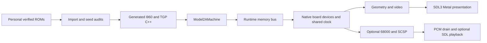

# Technical architecture

The target runs generated native C++ for Rally's i960 main CPU and TGP program,
with native Model 2A devices. It does not replace game logic with the earlier
lifted-C prototype. macOS is the active frontend target.

## Execution and coverage

[The pipeline](../scripts/segarally_recompile.py) verifies the supplied revision,
decodes reachable instructions and records seed provenance. Annotated labels,
audited bounded tables, straight-line continuations, object registrations and
actually observed missing targets remain distinct evidence classes. Candidates
are not proof that all indirect destinations or game paths are covered.

Reset copies program bytes `0x1000..0x60fff` to RAM `0x5a0000..0x5fffff`.
Generation uses the RAM addresses so relative transfers retain their meaning.
Every generated RAM instruction checks its live words. Generated code accesses
the machine through the [runtime bus](../src/runtime/model2a_bus.cpp); generated
output is never hand-edited. Unsupported accesses and missing targets stop
execution instead of skipping behavior.

Opt-in indexed dispatch replaces address-search and chunk routing with a sparse
page/word lookup. Membership remains exact, including holes and displacement
words. Instruction bodies, guards, cycle charges and boundary checks remain
unchanged. It is incompatible with the generator's `--fast_inaccuracy` mode.

An additional opt-in instruction boundary hook keeps execution inside a native
chunk across successive instructions. The shared clock and IRQ checks still
run before every instruction, and live-word guards and cycle charges remain
unchanged. Frame stops and budget stops preserve the old execution boundaries.
Each compiled chunk exports a version/layout marker; source and object audits
reject stale or incompatible builds. The original outer loop remains available
in the same binary for comparison. Actual old/new execution matches through
600 million driving instructions, including every frame, ordered write and IRQ;
the sound-enabled comparison also preserves every captured PCM sample.

## Machine and time

[Model2AMachine](../src/runtime/model2a_machine.cpp) owns the resumable CPU and
board state used by both bounded tools and the frontend. Instruction budgets
and rendered-frame stepping resume the same state. A frontier remains stopped;
another resume does not retry a partially executed instruction.

The [shared queue](../src/runtime/model2a_clock.cpp) orders device events by
deadline and insertion order. Bus accesses synchronize devices; CPU IRQ delivery
occurs at instruction boundaries. Main opcode costs are charged before memory
effects using pinned-reference deductions at 25 MHz. Those estimates are not
measured PCB timing and do not implement MAME's full timeslice machinery.
Input replays change cabinet pins at completed-render boundaries, as documented
in the [replay contract](segarally-input-replay.md).

The host's [Rally input adapter](../src/app/segarally_controls.cpp) maps SDL
keyboard/gamepad snapshots and touch actions to the same cabinet pins before
each resume. It adopts Daytona's button/half-axis binding model with Rally's
own ranges and wiring. Preferences and menu navigation stay outside Machine;
recordings retain the resolved cabinet inputs. A paused panel, focus loss or
scripted replay suppresses live controls until held inputs return to neutral.
Offline recording replay returns before controller initialization.

Native adapters cover I/O, EEPROM, communication, timers/IRQs, UART and video.
Communication uses explicitly disconnected endpoints; it does not claim linked
cabinet operation or execution of missing communication firmware. Drive commands
are latched without executing the missing drive-board firmware.

## Graphics and sound

Rally uploads its own verified 1,665-word TGP program. Shared geometry consumes
verified polygon and texture images plus CPU-written RAM. The
[video adapter](../src/runtime/model2a_video.cpp) preserves Model 2A mappings and
feeds the inherited CPU renderer or the shared SDL_GPU renderer. The dedicated
[host](../src/app/segarally_main.cpp) requires Metal on Mac. Polygon priority
retains window, sort-bucket, submission and face rules; camera depth does not
replace arcade ordering. The current stable GPU path uses triangle fans;
whole-polygon interpolation fidelity remains an open graphics task.

Rally's optional sound path uses its generated 68000 program, native SCSP and
physical UART/serial pin edges. Daytona uses a different Model 1 sound board;
its separate experimental sample-mixer mode in [native-audio.md](native-audio.md)
is also distinct from Rally's backend. Sound MMIO occurs at instruction
start boundaries; individual bus phases and value-bearing prefetch remain
unverified. The machine drains bounded 44.1 kHz stereo PCM without advancing
device clocks. SDL output primes 60 ms, caps its queue at 240 ms and limits
presentation-rate trim to ±0.5%. Capture and shared-core PCM agreement do not
establish speaker playback or complete sound parity.

## Validation boundaries

The independent i960 engine in [refcore](../src/refcore/i960_ref.cpp) checks
generated execution against separately instantiated shared board devices.
This catches CPU divergences but cannot prove the shared device implementation
correct against a complete MAME machine. Paired CPU/Metal renders use the same
generated CPU and test rendering/state agreement, not independent CPU parity.

Current floating-point diagnostics retain inherited host-double/reference
semantics. They do not satisfy the governing extF80 hardware requirement.
Full-race MAME comparison, PCB timing, extended precision and exact rasterization
remain separate requirements. See the [design](sega-rally-design.md) for detailed
contracts and the [status reference](segarally-status.md) for measured evidence.
